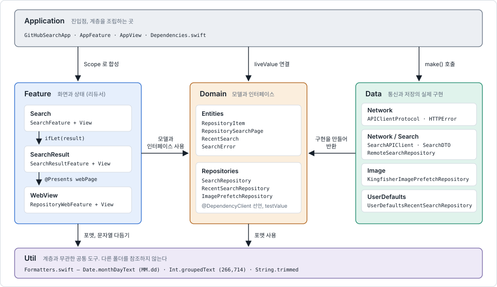
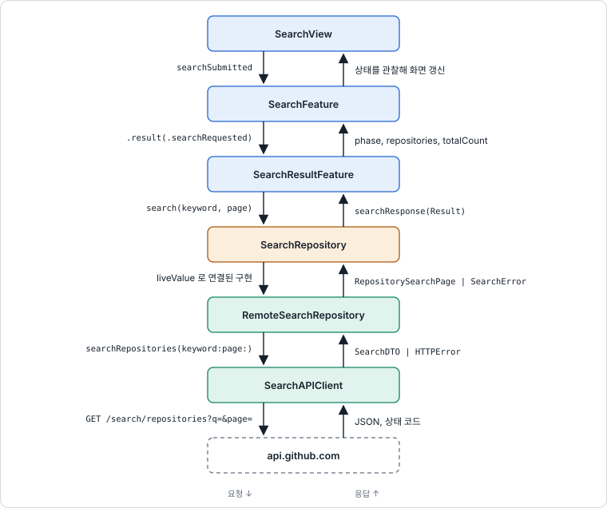

# ios-gitHubSearch

GitHub 저장소를 검색하는 iOS 앱입니다. 화면은 검색 화면과 검색 결과 화면 두 가지이고, 요구사항은 [docs/requirements/requirements.md](docs/requirements/requirements.md) 에 있습니다.

## 기능

| 화면 | 기능 |
|---|---|
| 검색 | 검색어를 입력해 저장소를 검색한다 |
| 검색 | 검색어가 비어 있으면 최근 검색어를 최신순으로 최대 10개 보여준다 |
| 검색 | 최근 검색어를 하나씩 또는 전부 지울 수 있고, 앱을 다시 켜도 남아 있다 |
| 검색 | 최근 검색어를 누르면 그 검색어로 검색한다 |
| 검색 | 입력 중에는 최근 검색어에서 뽑은 자동완성과 검색 날짜를 보여준다 (추가 구현) |
| 검색 결과 | 총 결과 수와 저장소 목록(썸네일, 이름, 소유자)을 보여준다 |
| 검색 결과 | 저장소를 누르면 WebView 로 저장소 페이지를 연다 |
| 검색 결과 | 목록의 70% 지점까지 내리면 다음 페이지를 미리 불러오고, 불러오는 동안 로딩 표시를 보여준다 (추가 구현) |
| 검색 결과 | 썸네일을 캐싱하고, 받은 페이지의 썸네일을 미리 받아 둔다 |
| 검색 결과 | 연결 실패와 호출 제한(`403`, `429`)을 구분해 안내하고 다시 시도할 수 있다 |

## 기술과 라이브러리

| 항목 | 내용 |
|---|---|
| 언어 | Swift 6 언어 모드 |
| 최소 버전 | iOS 17.0 |
| UI | SwiftUI. 저장소 페이지는 `WKWebView` |
| 테스트 | Swift Testing(`@Test`), TCA 의 `TestStore` |
| 패키지 관리 | Swift Package Manager |

외부 라이브러리는 두 개이고 버전을 고정했습니다.

| 라이브러리 | 버전 | 쓰는 곳 | 쓰는 이유 |
|---|---|---|---|
| [swift-composable-architecture](https://github.com/pointfreeco/swift-composable-architecture) (TCA) | `1.26.2` | `Application`, `Feature`, `Domain/Repositories`, `Data/Image` | 상태 변화를 리듀서 한 곳에 모으고, 의존성을 바꿔 끼워 `TestStore` 로 상태 변화를 빠짐없이 확인하기 위해 |
| [Kingfisher](https://github.com/onevcat/Kingfisher) | `8.16.0` | `SearchResultView`(`KFImage`), `Data/Image` | 썸네일의 메모리·디스크 캐싱과 프리패칭 |

- TCA 와 함께 오는 `Dependencies`, `DependenciesMacros` 로 저장소 인터페이스(`@DependencyClient`)를 선언합니다.
- Kingfisher 는 `KFImage` 를 쓰는 View 와 `App/Data/Image` 에서만 `import` 합니다. 리듀서와 `Domain` 은 Kingfisher 를 모릅니다.
- 통신은 `URLSession`, 최근 검색어 저장은 `UserDefaults` 를 그대로 씁니다.

## 아키텍처

앱 타깃 하나를 폴더로 나눈 TCA + Clean Architecture 구조입니다. 화면(`Feature`)은 `Domain` 의 모델과 인터페이스만 보고, 통신과 저장(`Data`)은 그 인터페이스의 구현을 만들어 돌려주며, `Application` 이 둘을 연결합니다.

### 계층과 의존 방향



화살표는 아는 쪽에서 알려지는 쪽으로 향합니다. `Feature` 와 `Data` 는 서로를 모르고 둘 다 `Domain` 만 압니다. `Domain` 은 다른 계층을 모릅니다. 어떤 구현을 쓸지는 `App/Application/Dependencies.swift` 한 곳에서 정합니다.

- 의존 방향은 `Feature` → `Domain` ← `Data` 입니다. 타깃이 하나라 컴파일러가 막아 주지 않으므로 규칙과 리뷰로 지킵니다.
- `Feature` 는 `APIClientProtocol`, `SearchAPIClient`, `HTTPError`, DTO 를 쓰지 않습니다.
- `Feature` 끼리는 `Search` → `SearchResult` → `WebView` 방향으로만 참조합니다.
- `Data` 는 `Domain` 타입을 `extension` 으로 넓히지 않습니다. 자기 타입의 `make` 가 저장소 값을 만들어 돌려줍니다.
- 리듀서는 `URLSession`, `UserDefaults`, 현재 시각을 직접 쓰지 않고 의존성으로 주입받습니다.
- UseCase 계층은 두지 않습니다. 리듀서가 그 역할을 합니다.
- `Util` 은 다른 폴더를 참조하지 않고, 어느 계층에서나 쓸 수 있습니다.

### 검색 한 번이 지나가는 길



파란 상자는 `Feature`, 주황 상자는 `Domain`, 초록 상자는 `Data` 입니다. 타입은 계층을 넘을 때마다 바뀝니다.

- 응답은 `Data` 안에서 `SearchDTO` 였다가 `Domain` 의 `RepositorySearchPage` 로 바뀌어 올라옵니다.
- `SearchAPIClient` 는 응답이 성공(2xx)인지만 확인하고, 아니면 상태 코드를 담은 `HTTPError` 를 던집니다. 상태 코드가 무슨 뜻인지는 `RemoteSearchRepository` 가 정해 `SearchError` 로 바꿉니다.
- 그래서 리듀서는 URL, JSON, 상태 코드를 알지 못합니다. 안내 문구는 `SearchError.message` 가 정합니다.
- 다음 페이지 요청은 `SearchResultFeature` 에서 시작하고, 그 아래로는 `page` 만 바꿔 같은 길을 지납니다.

## 폴더 구조

```
App/
├── Application/            진입점, 계층 조립
│   ├── GitHubSearchApp.swift
│   ├── AppFeature.swift
│   ├── AppView.swift
│   └── Dependencies.swift          저장소의 liveValue 를 정하는 곳
├── Feature/
│   ├── Search/             검색어 입력, 최근 검색어, 자동완성
│   │   ├── SearchFeature.swift
│   │   └── SearchView.swift
│   ├── SearchResult/       결과 목록, 로딩, 오류, 페이지 상태
│   │   ├── SearchResultFeature.swift
│   │   └── SearchResultView.swift
│   └── WebView/            저장소 페이지
│       ├── RepositoryWebFeature.swift
│       └── RepositoryWebView.swift
├── Domain/
│   ├── Entities/           화면과 저장소가 주고받는 모델과 오류
│   │   ├── RepositoryItem.swift
│   │   ├── RecentSearch.swift
│   │   └── SearchError.swift
│   └── Repositories/       저장소 인터페이스 (@DependencyClient, testValue)
│       ├── SearchRepository.swift
│       ├── RecentSearchRepository.swift
│       └── ImagePrefetchRepository.swift
├── Data/
│   ├── Network/            통신 계층의 공통 약속
│   │   ├── APIClientProtocol.swift
│   │   ├── HTTPError.swift
│   │   └── Search/         검색 API
│   │       ├── SearchAPIClient.swift
│   │       ├── SearchDTO.swift
│   │       └── RemoteSearchRepository.swift
│   ├── Image/              썸네일 미리 받기
│   │   └── KingfisherImagePrefetchRepository.swift
│   └── UserDefaults/       최근 검색어 저장
│       └── UserDefaultsRecentSearchRepository.swift
└── Util/                   계층과 무관한 공통 도구
    └── Formatters.swift

Tests/                      App/ 과 같은 폴더 구조
docs/
├── requirements/           과제 요구사항
├── sampleImage/            요구사항의 예시 화면
└── architecture/           이 문서의 그림
```

파일은 `App/` 이나 `Tests/` 아래에 넣기만 하면 타깃에 포함됩니다.

## 테스트

- 단위 테스트는 96개이고 Swift Testing 으로 씁니다. 리듀서는 `TestStore` 로 상태 변화를 확인합니다.
- 실제 네트워크를 호출하지 않습니다. 저장소 의존성을 바꿔 끼우거나 `URLProtocol` 가짜 응답을 씁니다.
- UI 테스트 타깃은 없습니다. 키보드 포커스처럼 화면에서만 드러나는 동작은 시뮬레이터에서 따로 확인했습니다.

## 실행 방법

Xcode 26.2 에서 만들고 확인했습니다.

1. 저장소를 클론합니다.
2. Xcode 에서 `GitHubSearch.xcodeproj` 를 열고 실행합니다.

GitHub 검색 API 를 인증 없이 호출하므로 요청을 분당 10회까지만 보낼 수 있습니다. 스크롤로 불러오는 다음 페이지도 한 번으로 셉니다. 넘으면 앱이 호출 제한 안내를 보여줍니다.

### 매크로 신뢰 확인

TCA 와 그 의존 패키지는 Swift 매크로를 사용합니다. Xcode 는 패키지 매크로를 처음 빌드할 때 직접 허용하기 전까지 빌드를 막고, 아래와 같은 오류를 보여줍니다.

```
Macro "ComposableArchitectureMacros" from package "swift-composable-architecture" must be enabled before it can be used
```

- **Xcode 에서 빌드할 때**: Issue navigator 에서 오류를 클릭하고 **Trust & Enable** 을 누릅니다. 매크로마다 한 번씩 허용하면 같은 버전에서는 다시 묻지 않습니다.
- **명령줄에서 빌드할 때**: 허용 창을 띄울 수 없으므로 `-skipMacroValidation` 옵션을 붙여 확인을 건너뜁니다.

### 명령줄 빌드와 테스트

```sh
xcodebuild test \
  -project GitHubSearch.xcodeproj \
  -scheme GitHubSearch \
  -destination 'platform=iOS Simulator,name=iPhone 17' \
  -skipMacroValidation
```

`-destination` 의 기기 이름은 설치된 시뮬레이터에 맞게 바꿉니다. 빌드만 하려면 `test` 대신 `build` 를 씁니다.

## 작업 방식

Claude Code 와 함께 GitHub 이슈 단위로 작업했습니다.

- 이슈마다 브랜치를 만들고, 계획 확인 → 구현 → 시뮬레이터 빌드와 테스트 → 검토 → PR 순서로 진행했습니다. 머지는 사람이 코드를 본 뒤에 했습니다.
- 규칙과 작업 흐름은 [CLAUDE.md](CLAUDE.md) 에, 흐름을 실행하는 명령과 검토용 서브에이전트는 `.claude/` 에 있습니다.
- 작업에 쓴 프롬프트와 그 결과는 [PROMPTS.md](PROMPTS.md) 에 이슈별로 정리했습니다.
