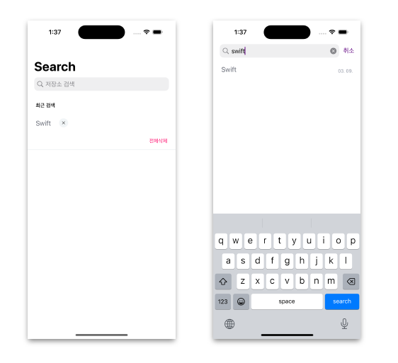
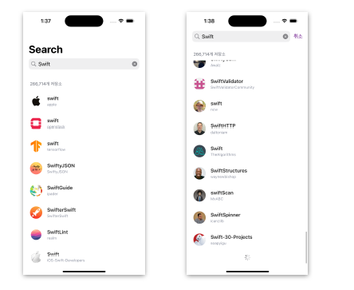

# 과제 요구사항

GitHub 저장소 검색 앱. 화면은 **검색 화면**과 **검색 결과 화면** 두 가지입니다.

작업 순서: 프로젝트 설계 → 검색 화면 → 검색 결과 화면 → 추가 구현(가장 마지막)

## 요구사항 1. 검색 화면

1. 검색어 입력 후, 검색 결과를 보여줍니다.
2. 검색어가 비어있을 시, 최근 검색어를 최대 10개까지 보여줍니다.
3. 최근 검색어는 날짜 기준으로 내림차순 정렬합니다.
4. 최근 검색어 '삭제' 또는 '전체 삭제'가 가능합니다.
5. 최근 검색 내역은 앱 재시작 시에도 유지됩니다.
6. 최근 검색어 선택 시, 검색 결과를 보여줍니다.

### 추가 구현

1. 검색어 입력 시, 자동완성을 보여줍니다.
2. 자동완성 노출 시, 검색 날짜를 같이 보여줍니다.
3. 자동완성은 최근 검색어에서 추출하여 사용합니다.

### 예시 화면



- 왼쪽: 검색어가 비어 있는 상태. 큰 제목 "Search", 검색창(placeholder "저장소 검색"), "최근 검색" 목록과 항목별 삭제(✕) 버튼, "전체삭제" 버튼
- 오른쪽: 검색어 입력 중. 검색창 옆 "취소" 버튼, 자동완성 항목과 오른쪽의 검색 날짜("03. 09.")

## 요구사항 2. 검색 결과 화면

1. 검색 결과를 List 형태로 보여줍니다.
2. 총 검색 결과 수를 보여줍니다.
3. 저장소 정보를 보여줍니다.
   - Thumbnail : `owner.avatar_url`
   - Title : `name`
   - Description : `owner.login`
4. 검색 결과 선택 시, WebView 를 통해 해당 저장소로 이동합니다.

### 추가 구현

1. Scroll 중간에 Next Page 를 미리 호출합니다.
2. Next Page 를 로딩할 때, 로딩 상태를 보여줍니다.

### Endpoint

```
[GET] https://api.github.com/search/repositories?q={keyword}&page={page}
```

예: `https://api.github.com/search/repositories?q=swift&page=1`

### 예시 화면



- 왼쪽: 검색 결과. 총 결과 수("266,714개 저장소")와 저장소 목록(썸네일, 제목, 설명)
- 오른쪽: 스크롤한 상태. 목록 맨 아래에 다음 페이지 로딩 표시
